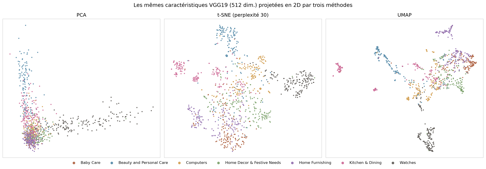
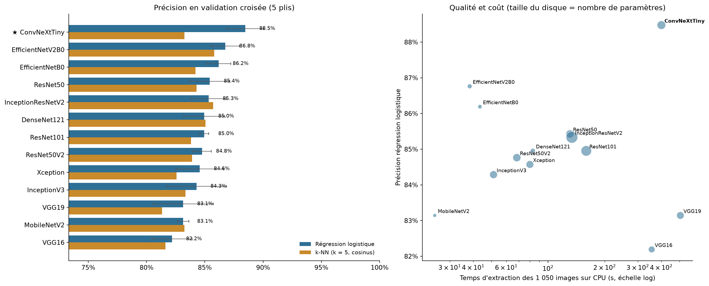
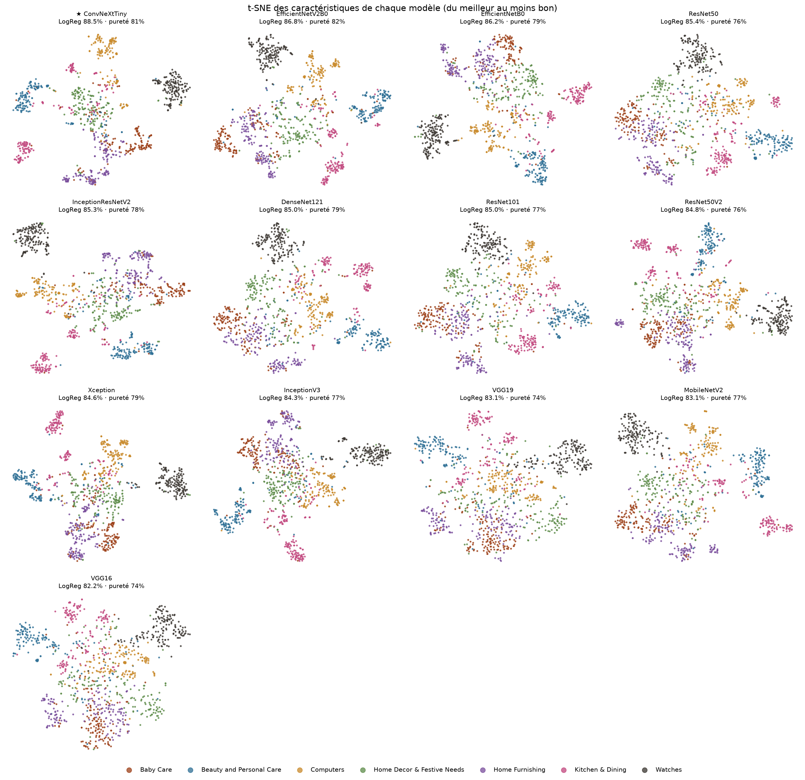

# TP — Transfert d'apprentissage avec VGG19 et visualisation t-SNE (Flipkart)

Réseaux de Neurones & Deep Learning II — Groupe 3

VGG19, pré-entraîné sur ImageNet et privé de ses couches entièrement connectées, sert d'extracteur de caractéristiques
pour 1 050 images de produits Flipkart (7 catégories). Chaque image devient un vecteur de 512 nombres (moyenne globale),
projeté en 2D avec t-SNE. On mesure ensuite si les catégories se séparent.


## Résultats

| Mesure | Valeur |
|---|---|
| Pureté du voisinage (10 voisins, 2D) | 74,6 % (hasard ≈ 14 %) |
| ARI K-means / vraies catégories | 0,48 |
| Silhouette du graphe 2D | 0,22 |
| Régression logistique sur les 512 caractéristiques (validation croisée 5 plis) | **82,3 % ± 2,9 %** |

Watches, Kitchen & Dining, Beauty and Personal Care et Computers se séparent bien. Baby Care, Home Furnishing et
Home Decor se recouvrent : ce sont surtout des textiles photographiés sur fond blanc, et certains produits (serviettes,
couvertures) apparaissent dans les deux premières catégories à la fois.

### Comparaison des projections et stabilité

| Projection | Pureté du voisinage | ARI | Silhouette |
|---|---|---|---|
| PCA | 45,6 % | 0,215 | −0,026 |
| t-SNE (perplexité 30) | 74,6 % | 0,482 | 0,217 |
| UMAP | 73,5 % | 0,388 | 0,166 |



Avec des perplexités de 5, 30 et 50, la pureté du t-SNE reste entre 72 % et 75 % : les blocs ne sont pas un artefact du réglage
(`resultats_vgg19/tsne_perplexites.png`). La matrice de confusion et les images mal placées sont dans la section 8,
le commentaire complet dans la section 9 du notebook.

## Comparaison de 13 modèles pré-entraînés

`TP_Comparaison_Modeles_Flipkart1.ipynb` reprend la même démarche avec 13 réseaux ImageNet (VGG16/19, ResNet, Inception,
Xception, DenseNet, MobileNet, EfficientNet, ConvNeXt). Classement complet : `resultats_comparaison/classement_modeles.csv`.

| Modèle | Précision LogReg (5 plis) | Pureté t-SNE | Paramètres | Temps d'extraction |
|---|---|---|---|---|
| ConvNeXtTiny | **88,5 %** | 80,8 % | 27,8 M | 401 s |
| EfficientNetV2B0 | 86,8 % | 81,6 % | 5,9 M | 38 s |
| EfficientNetB0 | 86,2 % | 78,6 % | 4,0 M | 43 s |
| VGG19 | 83,1 % | 73,8 % | 20,0 M | 506 s |
| VGG16 | 82,2 % | 73,8 % | 14,7 M | 356 s |

EfficientNetV2B0 obtient le meilleur rang moyen : presque aussi précis que ConvNeXtTiny, pour 5 fois moins de paramètres
et 10 fois moins de temps. VGG16 et VGG19 ferment la marche.





Les caractéristiques extraites (`carac_*.npz`, ~45 Mo) ne sont pas publiées : le notebook les recalcule.

## Lancer le TP

```bash
python -m pip install -r requirements.txt   # inclut umap-learn
jupyter notebook TP_VGG19_tSNE_Flipkart.ipynb
```

Le dépôt contient le fichier `Flipkart/flipkart_com-ecommerce_sample_1050.csv`, mais **pas les images** (352 Mo).
Placez les 1 050 images du jeu de données Flipkart dans `Flipkart/Images/`, à côté du notebook.
Le notebook détecte alors le dossier tout seul ; sinon, modifiez `DATA_DIR` dans la cellule des paramètres.

Au premier lancement, Keras télécharge les poids ImageNet de VGG19 (~80 Mo), et l'extraction des caractéristiques
prend quelques minutes sur CPU. Le résultat est mis en cache dans `resultats_vgg19/`.

## Contenu

- `TP_VGG19_tSNE_Flipkart.ipynb` : le notebook, exécuté, avec ses sorties
- `TP_Comparaison_Modeles_Flipkart1.ipynb` et `resultats_comparaison/` : la comparaison des 13 modèles
- `resultats_vgg19/` : figures et caractéristiques extraites (`caracteristiques_vgg19_1050.npz`)
- `Flipkart/` : le CSV des produits (images à ajouter)
