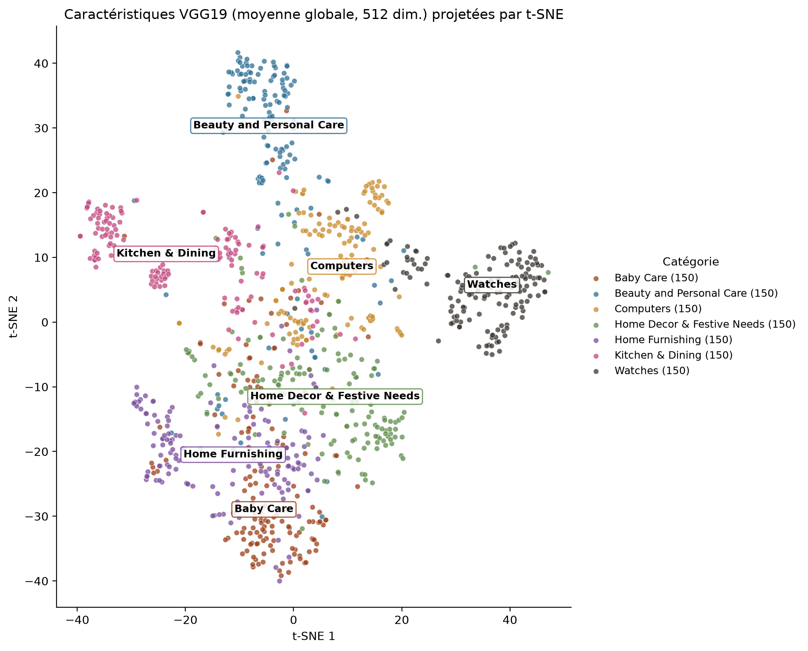

# TP — Transfert d'apprentissage avec VGG19 et visualisation t-SNE (Flipkart)

Réseaux de Neurones & Deep Learning II — Groupe 3

VGG19, pré-entraîné sur ImageNet et privé de ses couches entièrement connectées, sert d'extracteur de caractéristiques
pour 1 050 images de produits Flipkart (7 catégories). Chaque image devient un vecteur de 512 nombres (moyenne globale),
projeté en 2D avec t-SNE. On mesure ensuite si les catégories se séparent.



## Résultats

| Mesure | Valeur |
|---|---|
| Pureté du voisinage (10 voisins, 2D) | 74,6 % (hasard ≈ 14 %) |
| ARI K-means / vraies catégories | 0,48 |
| Silhouette du graphe 2D | 0,22 |
| Régression logistique sur les 512 caractéristiques (validation croisée 5 plis) | **82,3 % ± 2,9 %** |

Watches, Kitchen & Dining, Beauty and Personal Care et Computers se séparent bien. Baby Care et Home Furnishing
se confondent : la catégorie Baby Care contient beaucoup de serviettes de bain, visuellement identiques au linge de maison.
Le commentaire complet est à la fin du notebook.

## Lancer le TP

```bash
python -m pip install -r requirements.txt
jupyter notebook TP_VGG19_tSNE_Flipkart.ipynb
```

Le dépôt contient le fichier `Flipkart/flipkart_com-ecommerce_sample_1050.csv`, mais **pas les images** (352 Mo).
Placez les 1 050 images du jeu de données Flipkart dans `Flipkart/Images/`, à côté du notebook.
Le notebook détecte alors le dossier tout seul ; sinon, modifiez `DATA_DIR` dans la cellule des paramètres.

Au premier lancement, Keras télécharge les poids ImageNet de VGG19 (~80 Mo), et l'extraction des caractéristiques
prend quelques minutes sur CPU. Le résultat est mis en cache dans `resultats_vgg19/`.

## Contenu

- `TP_VGG19_tSNE_Flipkart.ipynb` : le notebook, exécuté, avec ses sorties
- `resultats_vgg19/` : figures et caractéristiques extraites (`caracteristiques_vgg19_1050.npz`)
- `Flipkart/` : le CSV des produits (images à ajouter)
